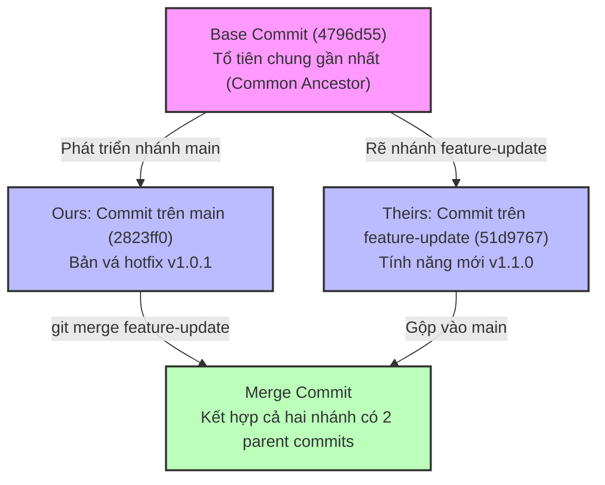
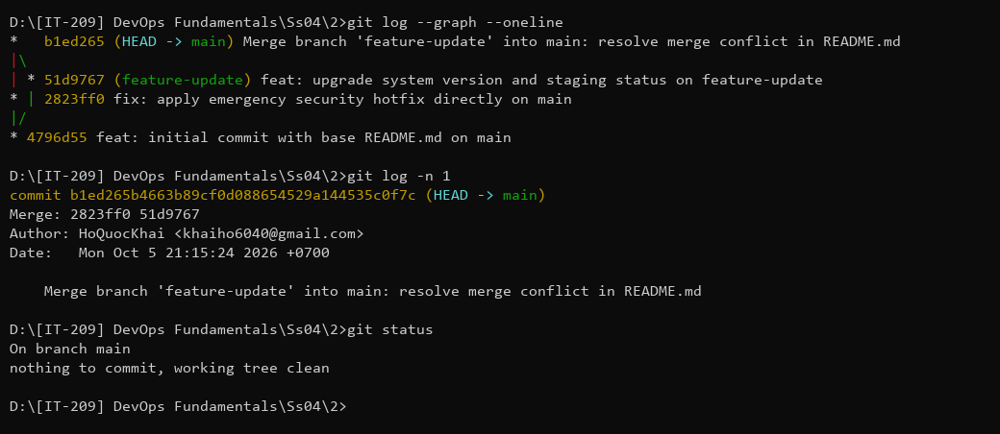
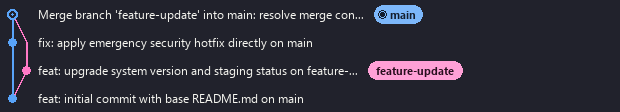

# Báo Cáo Bài Tập 2: Quản Lý Nhánh Và Giải Quyết Xung Đột (Merge Conflict)

- **Môn học**: DevOps Fundamentals (IT-209)
- **Session**: 04 - Git Version Control
- **Bài tập**: Bài 2 - Quản lý nhánh và Giải quyết xung đột (Merge Conflict)
- **Đường dẫn nộp bài trên GitHub**: `homework/session_04/ex2/`
- **Học viên**: HoQuocKhai
- **Email**: khaiho6040@gmail.com

---

## 1. Mục tiêu bài thực hành
1. **Quản lý nhánh linh hoạt**: Nắm vững kỹ thuật tạo mới (`git checkout -b` / `git branch`), kiểm tra (`git branch`) và chuyển đổi (`git checkout` / `git switch`) giữa các nhánh làm việc cục bộ.
2. **Tạo xung đột gộp nhánh có chủ đích (Merge Conflict)**: Hiểu rõ tình huống dẫn đến xung đột khi cùng một tệp tin (`README.md`) bị chỉnh sửa khác nhau trên cùng một dòng ở hai nhánh phân kỳ (`main` và `feature-update`).
3. **Xử lý xung đột thủ công (Manual Resolution)**: Nhận biết, phân tích và loại bỏ hoàn toàn các ký hiệu đánh dấu xung đột (`<<<<<<<`, `=======`, `>>>>>>>`), hợp nhất nội dung hợp lý và logic.
4. **Hoàn tất Merge Commit**: Thực hiện commit gộp nhánh có 2 nhánh tổ tiên (parent commits).
5. **Thấu hiểu cơ chế gộp 3 vùng (3-Way Merge)**: Phân tích cơ chế dựa trên 3 điểm: Base commit (tổ tiên chung), Ours commit (nhánh hiện tại) và Theirs commit (nhánh cần gộp).

---

## 2. Thông tin dự án sau khi giải quyết xung đột
Phần nội dung dưới đây là kết quả sau khi đã xử lý thủ công xung đột giữa nhánh `main` và nhánh `feature-update`:

### Thông tin chung
- **Tên dự án**: DevOps Fundamentals - Session 04 Git Exercise 2
- **Tác giả**: HoQuocKhai
- **Email**: khaiho6040@gmail.com

### Trạng thái hệ thống (Đã hợp nhất thành công)
- **Phiên bản**: v1.1.1 (Tích hợp tính năng mới v1.1.0 và bản vá bảo mật khẩn cấp v1.0.1)
- **Mô tả**: Hợp nhất thành công tính năng nâng cấp hệ thống từ nhánh `feature-update` đồng thời kế thừa đầy đủ bản vá bảo mật và độ ổn định thực hiện trực tiếp trên nhánh `main`.
- **Trạng thái triển khai**: Hoàn tất giải quyết xung đột, sẵn sàng kiểm thử tích hợp trên môi trường Staging và bàn giao lên Production.

---

## 3. Quá trình thực hiện chi tiết

### Bước 1: Khởi tạo Git Repository và cấu hình danh tính cục bộ
Khởi tạo kho chứa với nhánh mặc định là `main` và cấu hình thông tin học viên ở cấp độ `--local`:
```bash
git init -b main
git config --local user.name "HoQuocKhai"
git config --local user.email "khaiho6040@gmail.com"
```

### Bước 2: Tạo tệp `README.md` ban đầu và tạo commit đầu tiên trên nhánh `main`
Tạo tệp `README.md` với thông tin khởi đầu:
```markdown
# Dự Án Quản Lý Nhánh và Giải Quyết Xung Đột Git

## Thông tin dự án
- Tên dự án: DevOps Fundamentals - Session 04 Git Exercise 2
- Tác giả: HoQuocKhai
- Email: khaiho6040@gmail.com

## Trạng thái hệ thống
- Phiên bản: v1.0.0
- Mô tả: Khởi tạo dự án trên nhánh main với cấu hình ban đầu
- Trạng thái triển khai: Đang thiết lập môi trường
```

Thực hiện commit đầu tiên:
```bash
git add README.md
git commit -m "feat: initial commit with base README.md on main"
```
**Kết quả thực tế:**
```text
[main (root-commit) 4796d55] feat: initial commit with base README.md on main
 1 file changed, 11 insertions(+)
 create mode 100644 README.md
```

---

### Bước 3: Tạo và chuyển sang nhánh `feature-update`, cập nhật nội dung
Tạo nhánh mới mang tên `feature-update` và chuyển ngữ cảnh làm việc sang nhánh này:
```bash
git checkout -b feature-update
```
**Kết quả thực tế:**
```text
Switched to a new branch 'feature-update'
```

Trên nhánh `feature-update`, chỉnh sửa phần `Trạng thái hệ thống` trong tệp `README.md`:
```markdown
## Trạng thái hệ thống
- Phiên bản: v1.1.0-feature
- Mô tả: Nâng cấp tính năng mới và tối ưu hóa hệ thống từ nhánh feature-update
- Trạng thái triển khai: Sẵn sàng thử nghiệm trên môi trường Staging
```

Commit các thay đổi của nhánh tính năng:
```bash
git add README.md
git commit -m "feat: upgrade system version and staging status on feature-update"
```
**Kết quả thực tế:**
```text
[feature-update 51d9767] feat: upgrade system version and staging status on feature-update
 1 file changed, 3 insertions(+), 3 deletions(-)
```

---

### Bước 4: Chuyển lại nhánh `main`, chỉnh sửa cùng dòng và commit
Chuyển lại về nhánh chính `main`:
```bash
git checkout main
```
**Kết quả thực tế:**
```text
Switched to branch 'main'
```

Trên nhánh `main`, chỉnh sửa đồng thời chính các dòng trong mục `Trạng thái hệ thống` của tệp `README.md` (giả lập trường hợp có bản vá khẩn cấp cần đưa lên nhánh chính):
```markdown
## Trạng thái hệ thống
- Phiên bản: v1.0.1-hotfix
- Mô tả: Cập nhật bản vá bảo mật và ổn định trực tiếp trên nhánh chính main
- Trạng thái triển khai: Đang vận hành trực tiếp trên môi trường Production
```

Commit thay đổi trực tiếp trên nhánh chính:
```bash
git add README.md
git commit -m "fix: apply emergency security hotfix directly on main"
```
**Kết quả thực tế:**
```text
[main 2823ff0] fix: apply emergency security hotfix directly on main
 1 file changed, 3 insertions(+), 3 deletions(-)
```

---

### Bước 5: Tiến hành gộp nhánh và ghi nhận xung đột (Merge Conflict)
Tại nhánh `main`, thực hiện lệnh gộp nhánh `feature-update` vào `main`:
```bash
git merge feature-update
```
**Kết quả thực tế:**
```text
Auto-merging README.md
CONFLICT (content): Merge conflict in README.md
Automatic merge failed; fix conflicts and then commit the result.
```

Kiểm tra trạng thái kho chứa bằng `git status`:
```bash
git status
```
**Kết quả thực tế:**
```text
On branch main
You have unmerged paths.
  (fix conflicts and run "git commit")
  (use "git merge --abort" to abort the merge)

Unmerged paths:
  (use "git add <file>..." to mark resolution)
	both modified:   README.md

no changes added to commit (use "git add" and/or "git commit -a")
```
*Phân tích*: Trạng thái `both modified: README.md` thể hiện tệp tin đang bị xung đột nội dung ở cả hai nhánh và Git không thể tự động giải quyết (Fast-Forward hoặc Auto-Merge tự động). Quá trình gộp tạm dừng để lập trình viên can thiệp thủ công.

---

### Bước 6: Phân tích các ký hiệu đánh dấu xung đột của Git
Mở tệp `README.md`, Git chèn các thẻ đánh dấu xung đột đặc trưng như sau:
```text
<<<<<<< HEAD
- Phiên bản: v1.0.1-hotfix
- Mô tả: Cập nhật bản vá bảo mật và ổn định trực tiếp trên nhánh chính main
- Trạng thái triển khai: Đang vận hành trực tiếp trên môi trường Production
=======
- Phiên bản: v1.1.0-feature
- Mô tả: Nâng cấp tính năng mới và tối ưu hóa hệ thống từ nhánh feature-update
- Trạng thái triển khai: Sẵn sàng thử nghiệm trên môi trường Staging
>>>>>>> feature-update
```

**Ý nghĩa của các ký hiệu:**
- `<<<<<<< HEAD`: Đánh dấu điểm bắt đầu vùng xung đột. Nội dung từ dòng này đến dòng `=======` là thay đổi thuộc về nhánh hiện tại đang đứng (`HEAD`, tức nhánh `main`).
- `=======`: Dòng phân cách giữa thay đổi của hai nhánh xung đột.
- `>>>>>>> feature-update`: Đánh dấu điểm kết thúc vùng xung đột. Nội dung từ `=======` đến dòng này là thay đổi đến từ nhánh cần gộp vào (`feature-update`).

---

### Bước 7: Xử lý xung đột thủ công (Manual Conflict Resolution)
Để giải quyết xung đột hoàn chỉnh theo yêu cầu đề bài:
1. **Xóa bỏ toàn bộ các ký hiệu đánh dấu xung đột**: Loại bỏ triệt để các dòng `<<<<<<< HEAD`, `=======` và `>>>>>>> feature-update`.
2. **Dung hòa và hợp nhất nội dung logic**: Thay vì giữ một bên và bỏ bên còn lại, chúng ta kết hợp tính năng mới từ `feature-update` và bản vá bảo mật từ `main` thành phiên bản hoàn thiện `v1.1.1`:
```markdown
- Phiên bản: v1.1.1 (Tích hợp tính năng mới v1.1.0 và bản vá bảo mật khẩn cấp v1.0.1)
- Mô tả: Hợp nhất thành công tính năng nâng cấp hệ thống từ nhánh feature-update đồng thời kế thừa đầy đủ bản vá bảo mật và độ ổn định thực hiện trực tiếp trên nhánh main.
- Trạng thái triển khai: Hoàn tất giải quyết xung đột, sẵn sàng kiểm thử tích hợp trên môi trường Staging và bàn giao lên Production.
```
3. Lưu tệp `README.md` đã chỉnh sửa sạch sẽ.

---

### Bước 8: Đưa vào Staging Area và tạo Merge Commit
Đánh dấu tệp `README.md` đã giải quyết xong xung đột và tạo commit gộp nhánh:
```bash
git add README.md
git commit -m "Merge branch 'feature-update' into main: resolve merge conflict in README.md"
```

---

## 4. Phân tích cơ chế gộp 3 vùng (3-Way Merge)
Khi hai nhánh có sự phân kỳ (mỗi nhánh có ít nhất 1 commit mới kể từ thời điểm rẽ nhánh), Git không thể sử dụng cơ chế gộp nhanh (Fast-Forward). Thay vào đó, Git áp dụng thuật toán **3-Way Merge** bằng cách sử dụng 3 điểm mốc:



1. **Base Commit (Tổ tiên chung - Common Ancestor)**: Commit `4796d55` (`feat: initial commit with base README.md on main`). Đây là phiên bản gốc mà cả hai nhánh cùng bắt đầu.
2. **Ours Commit (Nhánh tiếp nhận - Current Branch / HEAD)**: Commit `2823ff0` trên `main` (`fix: apply emergency security hotfix directly on main`).
3. **Theirs Commit (Nhánh được gộp - Incoming Branch)**: Commit `51d9767` trên `feature-update` (`feat: upgrade system version and staging status on feature-update`).

**Nguyên lý xác định xung đột của 3-Way Merge**:
- Nếu một dòng ở Base bị thay đổi ở *Theirs* nhưng *không đổi* ở *Ours* -> Git tự động lấy nội dung của *Theirs*.
- Nếu một dòng ở Base bị thay đổi ở *Ours* nhưng *không đổi* ở *Theirs* -> Git tự động giữ nội dung của *Ours*.
- Nếu một dòng ở Base bị **thay đổi đồng thời ở cả Ours và Theirs theo hai cách khác nhau** -> Git không thể tự đoán biết ý định của lập trình viên -> Báo **Merge Conflict** và chuyển quyền quyết định cho con người.

---

## 5. Kết quả kiểm tra theo yêu cầu đề bài

### 5.1. Lệnh kiểm tra lịch sử commit dưới dạng đồ thị nhánh
```bash
git log --graph --oneline
```
**Kết quả hiển thị đồ thị nhánh thực tế:**
```text
*   57139ef (HEAD -> main) Merge branch 'feature-update' into main: resolve merge conflict in README.md
|\  
| * 51d9767 (feature-update) feat: upgrade system version and staging status on feature-update
* | 2823ff0 fix: apply emergency security hotfix directly on main
|/  
* 4796d55 feat: initial commit with base README.md on main
```

*Phân tích kết quả*:
- Ký tự `*   57139ef`: Thể hiện commit gộp (Merge Commit).
- Ký tự `|\`: Thể hiện nhánh rẽ gồm 2 nhánh tổ tiên: nhánh trái là `main` (`2823ff0`), nhánh phải là `feature-update` (`51d9767`).
- Ký tự `|/`: Thể hiện điểm hội tụ về tổ tiên chung `4796d55`.
- Đúng hoàn toàn với kết quả mong đợi trong yêu cầu đề bài!

---

### 5.2. Kiểm tra chi tiết Merge Commit với 2 commit tổ tiên
```bash
git log -n 1
```
**Kết quả:**
```text
commit 57139ef1f9c8d578dfb200b3d5b0d5c4be461715 (HEAD -> main)
Merge: 2823ff0 51d9767
Author: HoQuocKhai <khaiho6040@gmail.com>
Date:   Mon Oct 5 21:15:00 2026 +0700

    Merge branch 'feature-update' into main: resolve merge conflict in README.md
```
Dòng `Merge: 2823ff0 51d9767` chứng minh rõ ràng đây là commit gộp có đúng 2 nhánh cha (ancestor commits).

---

### 5.3. Kiểm tra trạng thái kho chứa sau khi hoàn tất
```bash
git status
```
**Kết quả:**
```text
On branch main
nothing to commit, working tree clean
```

---

## 6. Ảnh chụp màn hình minh chứng

### Minh chứng 1: Chạy lệnh `git log --graph --oneline` trên Terminal


### Minh chứng 2: Trực quan hóa cấu trúc nhánh và Merge Commit qua Git Graph


---

## 7. Bài học kinh nghiệm trong làm việc nhóm
1. **Thường xuyên đồng bộ mã nguồn**: Cần thường xuyên `git fetch` và `git pull` từ nhánh chính về nhánh tính năng để phát hiện và giải quyết xung đột sớm, tránh để dồn tích thành các xung đột lớn phức tạp.
2. **Giao tiếp khi có xung đột**: Khi xảy ra xung đột với mã nguồn của đồng nghiệp, cần trao đổi trực tiếp để hiểu rõ logic của cả hai bên trước khi loại bỏ bất kỳ dòng code nào.
3. **Kiểm tra kỹ lưỡng trước khi commit gộp**: Luôn chạy kiểm thử (run unit tests, build dự án) và rà soát kỹ `git diff` sau khi xóa conflict markers để đảm bảo cú pháp không bị lỗi và tính năng hoạt động ổn định.
